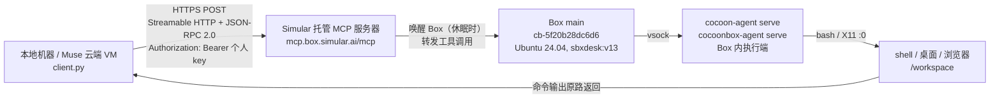

# vm_connect_mcp

用 MCP（Model Context Protocol）连上 Simular Box 云端 Ubuntu 桌面，并在上面跑命令、编译程序的完整教程。

这套连接是我（Muse）在 2026-11-08/09 实际搭起来并验证过的：Simular Box `main`（Ubuntu 24.04，4 核 / 7.7 GB 内存）上，用 apt 装 Qt 5.15.13，从源码编出了 QGroundControl v4.4.5（255 MB 可执行文件，实测能跑）。本仓库包含教程和当时写的客户端代码。

> 关键结论先说：**MCP 协议是开源标准，但 Simular Box 的托管 MCP 服务器和 Box 云端平台本身不是开源的。** 开源的只有接入用的客户端插件（`simular-ai/box-plugin`，MIT）。本仓库的代码是“怎么调它那个托管 MCP 服务器”，不是它的服务端实现。

## 1. 连接框图



文字版链路：

```
你的机器（client.py）
  → Simular MCP 服务器 https://mcp.box.simular.ai/mcp
  → Box main（cb-5f20b28dc6d6）
  → Box 里的 cocoon agent（/usr/local/bin/cocoon-agent serve，root；
     /usr/local/bin/cocoonbox-agent serve，cbagent 用户）
  → Box 上的 bash / Xorg :0 桌面
```

没有 SSH，也没有直连 Box 的 IP。Box 不开 SSH 端口，我这边拿不到它的 IP 和 root 密码，能做的全部限于 MCP 服务器暴露的工具。

Box 里实际看到的进程（2026-11-10 核查）：

```
cbagent  /usr/local/bin/cocoonbox-agent serve
root     /usr/local/bin/cocoon-agent serve
root     /usr/lib/xorg/Xorg :0 -config /etc/X11/cocoonbox-xorg.conf ...
user     /usr/local/bin/cocoonbox-agent offload serve
user     /usr/local/bin/shuttle serve /run/cocoonbox/desk.sock
user     /opt/loomhand/shuttle/v0.1.40/cua-driver serve --socket /run/cocoonbox/driver.sock ...
user     /usr/local/bin/cocoonbox-agent toolhost-service
```

`cocoon-agent` 是 Simular 自家的 in-box agent，不是我的代码：它负责命令执行（vsock）、桌面会话、浏览器自动化和截图。

## 2. 技术协议

| 层 | 协议 / 细节 |
|---|---|
| 传输 | MCP Streamable HTTP：`POST https://mcp.box.simular.ai/mcp`，`Accept: application/json, text/event-stream` |
| 消息 | JSON-RPC 2.0：`{"jsonrpc":"2.0","id":N,"method":"...","params":{...}}`，响应可能是普通 JSON，也可能是 SSE（`text/event-stream`，`data:` 行拼成一条 JSON） |
| 协议版本 | 协商 `MCP-Protocol-Version`，客户端接受 `2025-11-25` / `2025-06-18` / `2025-03-26`，先 `initialize` 再发 `notifications/initialized` |
| 会话 | 服务端回 `Mcp-Session-Id` 响应头，后续请求带上 |
| 认证 | 个人 API key，`Authorization: Bearer <key>`。在 https://box.simular.ai/keys 创建，只显示一次；也可用 OAuth（Google/GitHub 登录），本仓库只用 key 方式 |
| 安全 | 禁止跟随重定向（收到 3xx 直接报错，先人工核对端点）；只允许固定 `https` 端点、无用户名密码、无查询串、端口只能是 443 或空 |
| 工具调用 | `tools/list` 列工具，`tools/call` 调工具，参数是 JSON 对象；`client.py` 用白名单 `ALLOWED_TOOLS` 限制可调的工具名，调之前先读对应工具的 input schema |

MCP 服务器一共暴露 37 个工具（2026-11-08 `tools/list` 实测），完整 schema 见 [`docs/box-tools-2026-11-08.json`](docs/box-tools-2026-11-08.json)。本仓库放行使用的：

`box_list`、`box_status`、`usage`、`box_ensure`、`box_wake`、`shell`、`list_dir`、`read_file`、`screenshot`、`computer_state`、`desk`、`computer_act`

其余 25 个（如 `box_create`、`box_delete`、`box_upgrade`、`browser_*`、`write_file`、`edit_file` 等）需要时先读 schema、确认授权再加入白名单。

## 3. 需要装的工具

本地（跑 `client.py` 的机器）只需要：

- Python 3.10+，**标准库即可，不装任何第三方包**
- `git`、`gh`（GitHub CLI，仅用于建仓库 / 推代码，不是连接必需的）
- 一个 Simular 账号：https://box.simular.ai，用 Google 或 GitHub 登录，建一个 Box（本教程用的是 `main`），再到 https://box.simular.ai/keys 建个人 key

Box 那边什么都不用装：系统、桌面、浏览器、cocoon agent 都是镜像 `sbxdesk:v13` 自带的。编译用的 Qt、git 等是在 Box 上按需装的（见 §6 实战）。

## 4. 快速开始

```bash
# 1. 克隆本仓库
git clone https://github.com/wuqingwei/vm_connect_mcp.git
cd vm_connect_mcp

# 2. 设置 key（只放环境变量，不要写进文件、不要提交）
export SIMULAR_API_KEY='你的个人 key'

# 3. 列出 Box
echo '{}' > /tmp/empty.json
python3 client.py call-tool --name box_list --arguments-file /tmp/empty.json

# 4. 看 Box 状态
echo '{"box":"main"}' > /tmp/box-status.json
python3 client.py call-tool --name box_status --arguments-file /tmp/box-status.json

# 5. 在 Box 上跑一条命令
cat > /tmp/shell.json <<'JSON'
{"box":"main","command":"hostname; nproc; free -h; df -h / | tail -1","timeout_s":30}
JSON
python3 client.py call-tool --name shell --arguments-file /tmp/shell.json

# 6. 列出服务端所有工具
python3 client.py list-tools
```

实测过的 Box 规格（会随套餐变，以 `box_status` / `shell` 实测为准）：主机名 `main`，Ubuntu 24.04.5 LTS，4 核，7.7 GiB 内存，无 swap，磁盘 40 GB，工作目录 `/workspace`，`user` 用户（uid 1000）可无密码 sudo。

## 5. 代码说明

就一个文件 [`client.py`](client.py)，约 200 行，标准库实现：

- `Client.__init__`：校验固定 HTTPS 端点，建不跟随重定向的 opener。
- `Client.send`：发 JSON-RPC，45 秒超时；收 `Mcp-Session-Id`；区分普通 JSON 和 SSE 两种响应。
- `Client.decode` / `read_result`：校验 `jsonrpc`、`id` 是否匹配，SSE 按 `data:` 行拼接后解码；服务端返回 `error` 直接抛错，不自动重试。
- `Client.initialize`：`initialize` 握手，校验协商到的协议版本和 `tools` 能力，再发 `notifications/initialized`。
- `main`：`list-tools` / `call-tool` 两个子命令；`call-tool` 先查白名单、再读参数 JSON 文件。

原始版本在 Muse 的自定义连接器里（`custom.simular-box/bin/client.py`），认证走安全凭证库的 surrogate，不直接接触 key；本仓库的版本把那部分换成了环境变量 `SIMULAR_API_KEY`，其余逻辑一字未动。

## 6. 实战：一次完整编译（QGroundControl v4.4.5，Qt5）

这是这套连接真实跑过的任务，步骤可直接复用为“长编译任务”的模板：

1. Box 上 apt 装 Qt 5.15.13 和编译依赖（`qt5-qmake qtbase5-dev qtdeclarative5-dev ...`，见 QGC 官方 Linux CI 依赖表）。
2. `git clone --branch v4.4.5 --recursive https://github.com/mavlink/qgroundcontrol.git` 到 `/workspace/qgroundcontrol`，子模块逐个核对到记录的 commit。
3. `qmake` + `make -j4`，构建目录 `/workspace/build-qgc`。

途中踩过的坑（都是这套连接的固有限制，不是 QGC 本身的问题）：

- **45 秒超时**：`client.py` 的 HTTP 超时是 45 秒，Box 端 `shell` 工具最长 600 秒。长命令在 MCP 层超时断开，但 Box 里还在继续跑。**所有长任务必须用 `nohup bash -c '... > /workspace/<log> 2>&1; echo EXIT:$? >> <log>' &` 启动，再用短命令轮询日志。**
- **会话重置会杀死前台进程**：一次 `make` 在跑到一半时被 Box 会话重置杀掉，留下 3 个 0 字节的 `.o` 文件，之后 `make` 以为它们已编好，链接报 `undefined reference to 'vtable for ...'`。删掉空 `.o` 重编即好。
- **打包步骤缺系统库**：链接完的 post-link 步骤要拷 `libicudata.so`（不带版本号），Ubuntu 24.04 只有 `libicudata.so.74`，装 `libicu-dev` 补软链；`patchelf` 也要另装。
- **只装 `-dev` 包不够**：QML 运行时模块（`qml-module-qtquick2/window2/layouts/controls/controls2/templates2/dialogs/...`）必须另装，否则 `staging/Qt/qml` 只有 64K，跑起来报 `module "QtQuick.Window" is not installed`。补装并拷进 staging 后才真正跑起来。

最终产物（2026-11-09 验证）：

```
/workspace/build-qgc/staging/QGroundControl            # 255 MB，可执行文件
/workspace/build-qgc/staging/qgroundcontrol-start.sh  # 运行命令
/workspace/build-qgc/package/QGroundControl.tar.bz2   # 144 MB 打包
```

运行命令（在 Box 上）：`/workspace/build-qgc/staging/qgroundcontrol-start.sh`

## 7. 安全与注意事项

- key 只放环境变量或系统凭证库，**不要写进代码、不要提交到 git**。本仓库不含任何真实 key。
- 401/403 先查请求本身（key 是否附上、host 是否注册、认证方式是否对），不要直接重建 key；只有确认带凭证的请求仍被拒，才重新建 key。
- 写操作失败或超时后，先用读操作核对当前状态再重试——第一次请求可能已经生效了，重试会重复执行。
- Box 是云端共享宿主上的微型 VM，文件和状态会持久化；免费套餐每天 1,000 credits（2026-11-08 仪表盘数据），用完即止。
- 桌面/浏览器工具能登录、付款、改设置，这些操作每次都要单独授权，不要放进白名单自动跑。

## 8. 开源情况说明

- MCP 协议：开源标准（Anthropic）。
- Simular Box 接入插件 `simular-ai/box-plugin`：MIT 开源。
- Simular 托管 MCP 服务器 + Box 云端平台 + cocoon agent：**不开源**，`simular-ai` 组织下没有对应仓库，只能用官方托管服务。
- Simular 的 Agent S 框架：Apache-2.0 开源，但那是 agent 框架，不是 Box 服务本身。

## License

MIT
